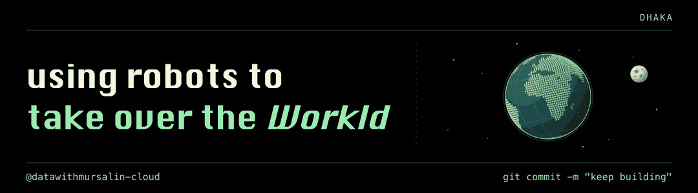

## Hi, I’m Syed and I’m

Even though I'm an Econ major, I taught myself to code in my spare time. In 2026 I learned my way around GitHub and got a little more *committed* to my work. The green squares shows how many times I *pushed* this year.

In and all, I enjoy vibe coding, and knowing a thing or two about data structures and AI tools helps me decide how pieces fit together in a project from creative web design to applications.

### Here's a sneek peek of the things I built that are public, and because I was bored.

- **[My portfolio](https://datawithmursalin-cloud.github.io/Portfolio/)** — Because I wanted to try Fable 5.2. [View the source](https://github.com/datawithmursalin-cloud/Portfolio)
- **[GRE & IELTS Practice Studio](https://datawithmursalin-cloud.github.io/GRE-IELTS-Practice-Studio/)** — A study app for timed GRE practice and IELTS exercises because why not. [View the source](https://github.com/datawithmursalin-cloud/GRE-IELTS-Practice-Studio)
- **[Take a Walk](https://github.com/datawithmursalin-cloud/Take-a-walk)** — A Swift app that lives in the Mac menu bar and reminds me to step away from your desk because of my lower back pain.
- **[Mac E-Mouse](https://github.com/datawithmursalin-cloud/Mac-E-Mouse-Public)** — I added trackpad-style scrolling and zoom to my multi-button mouse with a fork of Mac Mouse Fix.

[Find me on LinkedIn](https://www.linkedin.com/in/syedmursalin/)
